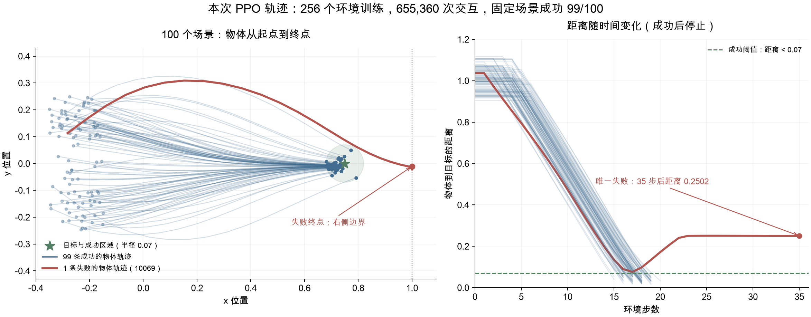
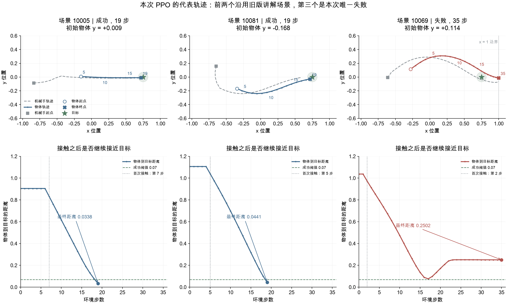

# Robot Learning Lab

A progressive robot learning project starting from simplified PyTorch-based 2D control tasks and gradually extending toward reinforcement learning, robot control, Isaac Lab, and manipulation tasks.

## Current Stage

v0.3 is complete. v0.4 includes Stable-Baselines3 PPO/SAC training, initial algorithm runs, and PPO trajectory diagnosis. The latest PPO run used 256 environments and 655,360 interactions, achieving 99/100 successes on the fixed evaluation set. Broader benchmarking is deferred.

A policy network controls a gripper in a low-dimensional environment. The current task is a push-to-target experiment, where the gripper should push an object toward a target position.

## Project Structure

- `env.py`: Defines the simplified robot environment, transition logic, reward function, and success condition.
- `Policy.py`: Defines the policy neural network.
- `Train.py`: Trains the policy using a REINFORCE-style policy gradient method.
- `Evaluate.py`: Loads the trained policy and evaluates it in a fixed test scenario.


## v0.3 — Gymnasium Interface

`gym_env.py` exposes the 6-dimensional observation and 2-dimensional continuous action through standard `reset()` and `step()` methods, with independent random sampling for each environment.

Environment behavior, Gymnasium/SB3 compatibility, and consistency with the original interface have been checked. Completed results and conclusions are recorded in the [development log](docs/development_log.md); existing numerical records remain under `results/v0.3/`.

## v0.4 — PPO and SAC Initial Runs

The project uses Stable-Baselines3 algorithms with the existing Gymnasium environment. Run in the `Robot_learning` Conda environment from the project directory:

```bash
python -B train_ppo.py --num-envs 256 --rollout-steps 256 --timesteps 655360 --seed 7
python -B train_sac.py --timesteps 20480 --seed 7
```

Each command saves a model and logs under `training_runs/v0.4/`, then evaluates the reloaded final model on 100 fixed scenarios. The [development log](docs/development_log.md) records completed runs, configurations, and results. The separate handwritten teaching examples are not imported by the project.


PPO defaults to 256 independent environments and 256 rollout steps per environment, giving 65,536 transitions per rollout. `--timesteps` counts transitions across all environments, not steps per environment, and must be a multiple of `num_envs * rollout_steps`. `--rollout-steps` can change the per-environment collection length. Without an explicit budget, PPO uses the smallest complete-rollout budget of at least 20,480 transitions (65,536 with the default settings).

`DummyVecEnv` batches policy inference and steps the lightweight environments sequentially in one process. Each environment has its own state and RNG; SB3 seeds the first reset with `seed + environment_index` and automatically resets completed episodes. Evaluation remains a separate single environment using the fixed evaluation seeds.

The original one-environment configuration can be reproduced with `python -B train_ppo.py --num-envs 1 --rollout-steps 256 --timesteps 20480 --seed 7`. SAC retains its single-environment setup. Existing run records keep their original settings and results.


## Latest Completed Results

All three runs below used training seed 7 and the same 100 evaluation initial states, with deterministic actions for evaluation.

| Run | Environments | Training interactions | Successful scenarios | Mean final distance | Mean episode return |
| --- | ---: | ---: | ---: | ---: | ---: |
| Initial PPO | 1 | 20,480 | 0/100 | 0.554076 | 4.844446 |
| PPO with expanded training | 256 | 655,360 | 99/100 | 0.043853 | 27.485413 |
| Initial SAC | 1 | 20,480 | 100/100 | 0.045325 | 27.411743 |

The PPO before/after experiment increased both total interactions and rollout size. Its improvement does not isolate the effect of environment count. PPO and SAC also have different training budgets in their latest runs, so these numbers do not establish a matched-budget algorithm ranking or reliability across training seeds.

The latest PPO model, configuration, training logs, and evaluation records are in [`training_runs/v0.4/ppo/20261029T005032_984643Z_seed7/`](training_runs/v0.4/ppo/20261029T005032_984643Z_seed7/). Earlier PPO and SAC runs remain alongside it.

### Latest PPO Trajectories

The saved PPO model was replayed on all 100 evaluation scenarios, reproducing the recorded results. Blue paths reach the target; the red path is the sole failure, which approaches the goal, overshoots, and ends at the right boundary.





Trajectory coordinates and replay records are saved in [`results/ppo_256_training_trajectories/`](results/ppo_256_training_trajectories/). Experiment reasoning and the before/after comparison are recorded in the English [development log](docs/development_log.md), under the requested record date of 2026-09-16. Run-directory timestamps preserve the actual run time.
